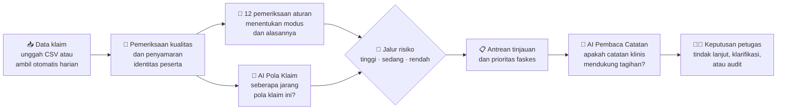

<div align="center">

# 🛡️ Claim Integrity Radar

### Periksa yang paling penting dulu. Lindungi yang jujur.

**Sistem pendukung keputusan audit klaim JKN** yang menemukan pola *phantom billing*, *cloning*, *repeat billing*, dan klaim fiktif obat/alkes, menjelaskan alasannya dalam bahasa manusia, lalu mengurutkan klaim dan faskes yang paling layak diperiksa lebih dulu.

[](#)
[](#)


[Masalah](#-masalah) · [Cara kerja](#%EF%B8%8F-cara-kerja) · [Modus](#-lima-modus-yang-dikenali) · [Fitur](#-fitur-unggulan) · [Hasil uji](#-hasil-uji) · [Menjalankan](#-menjalankan-secara-lokal)

</div>

---

## 🚨 Masalah

| | |
|---|---|
| 📄 **±650.000** berkas klaim per hari | Mustahil diperiksa semua dengan usaha yang sama |
| ⚠️ **±5%** berkas terindikasi bermasalah | Sekitar 32.500 berkas per hari, sementara auditor terbatas |
| 💸 **108,72%** rasio klaim terhadap iuran | Setiap rupiah yang salah bayar menekan keberlanjutan JKN |

> Pertanyaannya bukan lagi *"apakah ada kecurangan?"*, tetapi **"mana yang harus diperiksa lebih dulu, dan kenapa?"**
>
> <sub>Angka dari pernyataan publik BPJS Kesehatan yang dikutip media; lihat [referensi](docs/referensi-dan-sumber-data.md).</sub>

## 💡 Solusinya dalam tiga kata

| 🔎 **Periksa** | 💬 **Jelaskan** | 🎯 **Prioritaskan** |
|:---:|:---:|:---:|
| 12 pemeriksaan aturan + 2 AI menilai setiap klaim | Setiap tanda risiko disertai alasan, data pemicunya, dan berkas yang perlu diminta | Klaim dan faskes diurutkan: risiko tinggi dulu, atau yang paling efisien diaudit |

Claim Integrity Radar **bukan pengganti verifikator**. Sistem ini mengarahkan perhatian ke kasus yang paling layak diperiksa. **Keputusan akhir selalu di tangan petugas.**

## ⚙️ Cara kerja



| Komponen | Pertanyaan yang dijawab |
|---|---|
| 📏 **Pemeriksaan aturan** | *Kejanggalan apa yang ada, dan modus apa?* Alasannya bisa dibaca dan diperiksa ulang. |
| 🤖 **AI Pola Klaim** (Isolation Forest) | *Seberapa jarang pola klaim ini dibanding klaim lain?* Memperkuat temuan aturan dan menemukan klaim janggal yang lolos dari aturan. |
| 📝 **AI Pembaca Catatan** (LLM lokal) | *Apakah catatan klinis mendukung diagnosis, keparahan, dan lama rawat yang ditagihkan?* |
| 👩‍⚕️ **Petugas** | *Benar perlu ditindaklanjuti, atau ternyata wajar?* Keputusan ini menjadi ukuran ketepatan sistem. |

## 🧭 Lima modus yang dikenali

| Modus | Artinya | Sistem menandai bila | Biasanya berperan |
|---|---|---|---|
| 👻 **Phantom billing** | Menagih layanan yang tidak pernah diberikan | Layanan per hari melebihi kapasitas faskes, tanpa bukti sesi, atau banyak dicatat pada menit yang sama | Penagihan atau manajemen faskes |
| 📑 **Cloning** | Catatan klinis pasien lain disalin | Catatan sama kata demi kata, termasuk tanda vital dan hasil lab, pada peserta berbeda | Dokter atau petugas rekam medis |
| 🔁 **Repeat billing** | Layanan yang sama ditagih lebih dari sekali | Peserta, tanggal, diagnosis, dan INA-CBG sama, atau satu masa rawat dipecah | Bagian klaim faskes |
| 💊 **Klaim fiktif obat/alkes** | Obat atau alat khusus ditagih tanpa diberikan | Pasangan INA-CBG dan obat/alat tidak lazim, atau tanpa resep dan bukti penyerahan | Farmasi atau penagihan faskes |
| 📈 **Upcoding / lama rawat** | Klaim dibuat tampak lebih berat | Keparahan tinggi tanpa penyakit penyerta, atau lama rawat jauh di atas klaim sejenis | Petugas pengkodean (koder) |

> Peran di atas berasal dari pola kasus yang pernah terungkap, **bukan tuduhan kepada orang tertentu**.

## ✨ Fitur unggulan

| | |
|---|---|
| 🏠 **Beranda "Prioritas hari ini"**<br/>Ringkasan harian, KPI dibanding analisis sebelumnya, dan faskes paling mendesak | 📋 **Antrean tinjauan**<br/>Jalur merah/kuning/hijau, label modus, filter per modus, dan pintasan keyboard |
| 🔬 **Halaman klaim yang menjelaskan dirinya**<br/>Temuan dikelompokkan per modus, sorotan di catatan klinis, pasangan catatan identik, dan linimasa kunjungan | 🏥 **Prioritas faskes**<br/>Kalimat vonis, paket bukti, dan indeks prioritas audit *risiko × nilai ÷ usaha audit* |
| 🗺️ **Peta Risiko Indonesia**<br/>Porsi klaim berisiko per provinsi, mode peta dan petak, dibanding rata-rata nasional | 📈 **Tren**<br/>Klaim berisiko per hari dan ketepatan sistem menurut keputusan verifikator |
| 📥 **Dua jalur data**<br/>Unggah CSV, atau folder kiriman yang diambil otomatis setiap hari | 🌗 **Mode gelap, Ctrl+K, dan animasi halus**<br/>Nyaman dipakai seharian |
| 🔐 **Akses per peran dan riwayat keputusan**<br/>Admin, operator data, verifikator, audit lead, dan penguji demo | ⚖️ **Uji keadilan**<br/>Porsi penandaan per provinsi, kelas, dan kepemilikan faskes |

## 📊 Hasil uji

> ⚠️ **Semua angka berasal dari data sintetis berlabel**, bukan kinerja pada data JKN. Data sintetis berpola lebih jelas daripada data nyata.

**Perbandingan cara memeriksa** (29.628 klaim, 40 RS, 17 provinsi, 2,9% curang dalam 8 modus)

| Cara memeriksa | Kecurangan per 100 berkas pertama | Klaim sah ikut diperiksa |
|---|:---:|:---:|
| 🎲 Audit acak | 2,9 | 3,7% |
| 📏 Aturan sederhana (satu aturan mana pun) | 9,4 | 26,9% |
| 🛡️ **Claim Integrity Radar** | **94** | **1,0%** |

**Modus utama proposal yang tertangkap pemeriksaan aturan:** 👻 301/301 · 📑 72/72 · 🔁 88/88 · 💊 110/110

**Kartu bukti dari kit penilaian resmi Workshop #3** (kapasitas audit 880 klaim)

| Metrik | Hasil |
|---|---|
| Ketepatan pada 880 klaim teratas | **0,80** (26× pemilihan acak) |
| Rupiah kecurangan yang tertangkap | **90,6%** |
| RS jujur yang ikut diaudit | 8 dari 27 |
| Uji plasebo (data tanpa kecurangan) | 27 klaim ditandai |
| Uji permutasi | p = 0,001 |

<details>
<summary>🔍 <b>Kelemahan yang kami temukan dan laporkan apa adanya</b></summary>

- Menambah AI pada aturan **belum terbukti** menaikkan ketepatan secara signifikan (p = 0,29). Yang jelas naik adalah rupiah yang tertangkap.
- Jenis kecurangan baru yang tidak punya aturan (penggelembungan prosedur) **tidak tertangkap** (0 dari 60).
- *Upcoding* yang disamarkan dengan diagnosis sekunder palsu turun dari 24 menjadi 9 dari 55 yang tertangkap.
- Data uji dibuat tim yang sama dengan pembuat pemeriksa, dan belum ada validasi pakar klinis.

Rincian lengkap: [`docs/analytics-spec.md`](docs/analytics-spec.md) dan [`docs/perubahan-dari-proposal.md`](docs/perubahan-dari-proposal.md).

</details>

## 🔐 Privasi dan tata kelola

- 🧪 **Demo hanya memakai data sintetis.** Nomor peserta diawali `SYN`; cara pembuatannya dijelaskan di [`demo-data/README.md`](demo-data/README.md).
- 🎭 **Identitas disamarkan** menjadi kode acak sebelum dianalisis.
- 🏠 **AI internal.** Model bahasa berjalan lokal lewat Ollama, sehingga catatan tidak keluar dari server.
- 🚫 **Biaya pasca-verifikasi (FKL48) tidak pernah dipakai**, dan nilai tagihan tidak memengaruhi skor risiko atau AI.
- 👩‍⚕️ **Manusia memutuskan.** Setiap keputusan tercatat beserta pembuatnya (sejalan dengan UU PDP No. 27/2022).

## 🧰 Teknologi

| Lapisan | Teknologi |
|---|---|
| Antarmuka | React 18 · TypeScript · Vite · Tailwind CSS 4 · Recharts |
| API | Python · FastAPI · Uvicorn |
| Analitik dan AI | pandas · NumPy · scikit-learn (Isolation Forest) · Ollama + Qwen3 4B |
| Basis data | PostgreSQL (operasional) · SQLite (pengembangan dan demo) |
| Pengujian | pytest · Playwright |

```
claim-integrity-radar/
├── backend/      FastAPI, 12 pemeriksaan aturan, AI, jalur risiko, penyimpanan
├── frontend/     React: Beranda, Antrean, Peta Risiko, Tren, Faskes, Data & Analisis
├── demo-data/    Data contoh sintetis berformat kolom klaim BPJS
└── docs/         Spesifikasi analitik, kontrak API, perubahan dari proposal, referensi
```

## 🚀 Menjalankan secara lokal

<details>
<summary><b>Backend (Python 3.10+)</b></summary>

```bash
cd backend
python -m venv .venv
.venv\Scripts\activate          # macOS/Linux: source .venv/bin/activate
pip install -r requirements.txt

# Akun admin demo (admin / admin123), sekali saja
set CIR_ENV=development
set CIR_ADMIN_BOOTSTRAP_SECRET=rahasia-lokal
python -m app.security.bootstrap_admin --local-demo

set CIR_COOKIE_SECURE=false
uvicorn app.main:app --port 8000
```
</details>

<details>
<summary><b>Frontend (Node.js 20+)</b></summary>

```bash
cd frontend
npm install
npm run dev                      # buka http://localhost:5173
```
</details>

<details>
<summary><b>Mengisi data demo</b></summary>

Masuk ke **Data & Analisis → Unggah**, lalu pilih `demo-data/demo-3-operasional.csv`, atau isi otomatis:

```bash
cd backend
python -m scripts.seed_demo_database --username admin --base-url http://127.0.0.1:8000
```

Agar **AI Pembaca Catatan** memakai model, pasang [Ollama](https://ollama.com) lalu jalankan `ollama pull qwen3:4b`. Tanpa Ollama, sistem memakai pembacaan cadangan berbasis aturan teks.
</details>

## 📚 Dokumentasi

| Dokumen | Isi |
|---|---|
| [`docs/analytics-spec.md`](docs/analytics-spec.md) | Cara kerja pemeriksaan, AI, dan hasil uji |
| [`docs/api-contracts.md`](docs/api-contracts.md) | Kontrak API frontend–backend |
| [`docs/perubahan-dari-proposal.md`](docs/perubahan-dari-proposal.md) | Apa yang berubah dari proposal dan alasannya |
| [`docs/referensi-dan-sumber-data.md`](docs/referensi-dan-sumber-data.md) | Sumber data, materi, dan lisensi |

<div align="center">

**Universitas Brawijaya · Healthkathon BPJS Kesehatan 2026**

<sub>Hasil sistem adalah petunjuk pemeriksaan, bukan bukti kecurangan. Keputusan tetap di tangan petugas.</sub>

</div>
