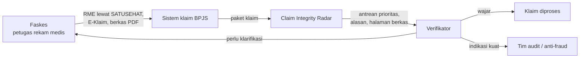
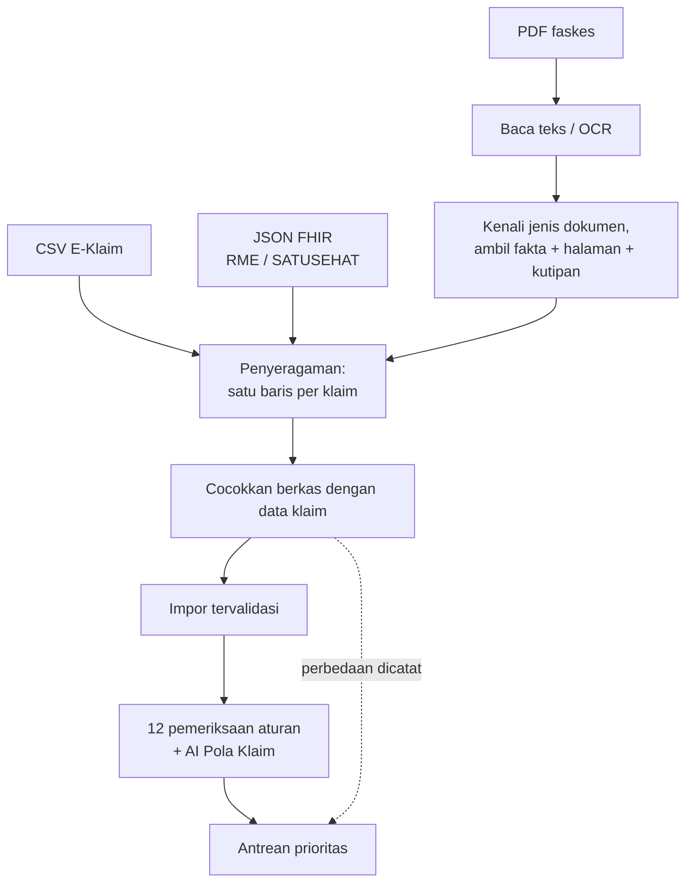
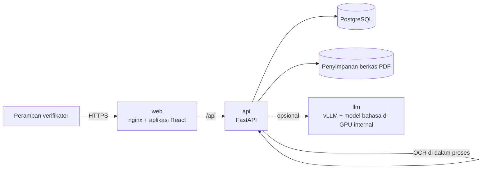

# Panduan Penerapan Claim Integrity Radar

Dokumen ini untuk tim TI dan tim verifikasi yang akan memasang dan menjalankan Claim Integrity Radar di lingkungan sendiri. Isinya: posisi sistem dalam proses klaim, sumber data yang dibaca, arsitektur, pilihan komponen AI beserta alasannya, kebutuhan server, dan langkah pemasangan.

Semua angka hasil uji di dokumen ini berasal dari **data sintetis**. Angka yang dikutip dari sumber luar diberi tautan dan disebut sebagai perkiraan.

## 1. Posisi dalam proses bisnis klaim

Radar dipakai pada **tahap verifikasi**, setelah faskes mengajukan klaim dan sebelum klaim disetujui. Radar tidak menyetujui atau menolak klaim. Radar menentukan klaim mana yang diperiksa lebih dulu, menjelaskan alasannya, dan menunjukkan berkas yang mendasarinya.



| Peran | Yang dilakukan di Radar |
|---|---|
| **Verifikator** | Semua pekerjaan verifikasi dengan satu login: memasukkan paket klaim, menjalankan analisis, membuka antrean, membaca berkas, bertanya ke berkas, dan mencatat keputusan. |
| **Administrator** | Semua pekerjaan verifikator, ditambah mengelola akun dan membaca log keamanan. |

Faskes tidak login ke Radar. Berkas faskes masuk lewat sistem klaim yang sudah ada, lalu diteruskan ke Radar.

## 2. Sumber data yang dibaca

Sejak SEB RME–SATUSEHAT (30 Juli 2026), klaim JKN beralih dari berkas PDF hasil pindai ke data rekam medis elektronik. Selama masa transisi sampai 2027, dan sesudahnya untuk klaim pending, dispute, dan koreksi audit, PDF tetap ada ([ringkasan aturan](https://legawa.com/2026/10/07/rme-terintegrasi-satusehat-kredensialing-fkrtl/), [berita](https://investortrust.id/national/111350/cegah-fraud-mulai-agustus-2026-rs-didorong-terapkan-klaim-elektronik)). Karena itu Radar menerima tiga bentuk sumber dalam satu paket:

| Sumber | Bentuk | Cara dibaca |
|---|---|---|
| Data E-Klaim | CSV berformat kolom klaim FKRTL | Dibaca langsung |
| RME / SATUSEHAT | JSON, Bundle HL7 FHIR R4 | `Encounter`, `Patient`, `Organization`, `Condition`, `Procedure`, `Claim`, `Composition` (resume medis), dan `DocumentReference` (bukti) dipetakan ke kolom yang sama |
| Berkas faskes | PDF digital | Lapisan teks dibaca langsung |
| Berkas faskes | PDF hasil pindai | OCR; halaman yang terbaca kurang yakin dibaca ulang oleh model bahasa-visual |



Aturan penggabungan:

- **Berkas ditautkan ke klaim lewat nomor kunjungan** yang tercetak di berkas.
- **Berkas melengkapi data yang kosong**: catatan klinis dari resume medis, dan daftar bukti yang tersedia (catatan sesi terapi, resep, bukti penyerahan obat, permintaan dan bukti pemasangan alat).
- **Bila isi berkas berbeda dari data klaim, data klaim yang dipakai** untuk analisis, dan perbedaannya dicatat untuk verifikator. Sistem tidak pernah memilih diam-diam.
- **Klaim yang hanya ada sebagai PDF** dibentuk dari isi dokumennya.
- **Model bahasa hanya membaca yang tidak terbaca pembaca formulir** saat paket masuk (jenis dokumen tak dikenal, atau resume tanpa ringkasan yang terbaca), supaya unggahan tetap cepat. Pembacaan klinis sebuah catatan diminta verifikator per klaim.
- **Setiap nilai yang dibaca menyimpan halaman dan kutipannya.** Kutipan dari model bahasa hanya diterima bila memang ditemukan di halaman itu; yang tidak ditemukan ditandai dan tidak dipakai.

Pemetaan FHIR memakai *namespace* proyek ini untuk kode khas BPJS (INA-CBG, tambahan khusus, atribut faskes), karena profil nasionalnya tidak tersedia terbuka dalam bentuk ini. Saat integrasi, pemetaan di `backend/app/intake/fhir.py` disesuaikan dengan profil resmi SATUSEHAT dan E-Klaim.

### Hasil uji pembacaan (data sintetis)

Paket uji `demo-data/demo-4-multisumber`: 28.510 klaim di CSV, 1.113 klaim di FHIR, 240 PDF (81 hasil pindai), 5 klaim yang hanya ada di PDF, dan 3 PDF yang sengaja dibuat berbeda dari data klaim.

| Ukuran | Hasil |
|---|---|
| Klaim tergabung | 29.628, sama dengan data asal |
| Berkas tertaut ke klaimnya | 240 dari 240 |
| Jalur risiko dibanding data asal | Sama persis: 488 tinggi, 604 sedang; 0 klaim berbeda |
| Perbedaan berkas vs data yang ditanam | 3 dari 3 ditemukan |
| Isian terbaca benar, PDF digital | 1.213 dari 1.213 |
| Isian terbaca benar, PDF hasil pindai | 617 dari 617 |
| Jenis dokumen dikenali, PDF hasil pindai | 81 dari 81 |
| Waktu OCR | sekitar 2 detik per halaman pada CPU laptop |

Cara mengulang: `python -m scripts.evaluate_document_reader` (dari folder `backend`).

**Batasan yang perlu diketahui.** Berkas uji adalah formulir cetak yang rapi dengan sedikit kemiringan dan noda. Berkas nyata memuat tulisan tangan, stempel, tabel, dan pindaian miring atau buram; ketepatannya akan lebih rendah dan harus diukur ulang pada sampel berkas nyata sebelum dipakai. Itulah gunanya pembaca tingkat kedua (model bahasa-visual) dan tanda "hasil OCR kurang yakin" di layar.

## 3. Arsitektur



| Komponen | Teknologi | Catatan |
|---|---|---|
| Web | React, TypeScript, nginx | Hanya berkas statis; meneruskan `/api` ke API |
| API | Python, FastAPI | Autentikasi, impor, analisis, tinjauan, jejak audit |
| Basis data | PostgreSQL 16 | Skema dibuat oleh migrasi berversi (`python -m scripts.db_migrate`), hanya menambah |
| Berkas PDF | Folder di server (`CIR_DOCUMENT_DIR`) | Dinamai dengan *hash* isi; metadata dan teks halaman di basis data |
| AI Pola Klaim | Isolation Forest (scikit-learn) | Dilatih dari data sampel klaim yang disamarkan; berjalan di CPU |
| OCR | PP-OCRv6 lewat RapidOCR (ONNX) | Di dalam API, CPU, tanpa internet |
| Model bahasa | Endpoint kompatibel OpenAI | vLLM di GPU internal; opsional |

Tanpa model bahasa, sistem tetap berjalan penuh: isian formulir dibaca dengan pola, catatan klinis dinilai dengan aturan teks, dan "Tanya berkas" menjadi pencarian teks. Model bahasa menambah kemampuan membaca teks bebas, bukan syarat jalan.

## 4. Pilihan komponen AI dan alasannya

### Model bahasa: Gemma 4 31B

| Pertimbangan | Gemma 4 31B |
|---|---|
| Bahasa Indonesia | Peringkat pertama model terbuka pada [SEA-HELM bahasa Indonesia](https://leaderboard.sea-lion.ai/detailed/ID) (skor 79,75 per 18 September 2026); berikutnya Qwen 3.6 27B (77,96) dan SEA-LION v4.5 27B (76,51) |
| Lisensi | [Apache 2.0](https://the-decoder.com/googles-gemma-4-is-now-available-with-apache-2-0-licensing-for-the-first-time/): boleh dipakai komersial, diubah, dan dijalankan sendiri tanpa royalti |
| Jalan di server sendiri | Bobot terbuka; satu GPU 80 GB cukup untuk presisi penuh ([uji vLLM](https://markaicode.com/benchmarks/cuda-gemma-4-h100-latency-benchmark/)) |
| Membaca gambar | Ya; dipakai untuk halaman pindaian yang OCR-nya kurang yakin |

Mengapa bukan layanan API model tertutup: catatan klinis adalah data pribadi yang bersifat spesifik. Mengirimnya ke luar negeri tunduk pada syarat Pasal 56 UU 27/2022 dan penilaian dampak pelindungan data ([ulasan](https://www.hukumonline.com/berita/a/fasilitasi-transfer-data-dalam-art-tetap-berpayung-uu-pdp-lt699bfed1d8e8b/?page=2)). Dengan model terbuka di server internal, data tidak pernah keluar.

Model yang sama bisa dipanggil lewat Gemini API untuk demo dan pengembangan **dengan data sintetis saja**. Layanan gratisnya boleh memakai isi permintaan untuk pengembangan produk ([ketentuan](https://ai.google.dev/gemini-api/terms_preview)), jadi tidak boleh dipakai untuk data nyata.

Cara model dipakai dibatasi dengan sengaja:

- **Model mengambil fakta, aturan yang menilai.** Pada uji internal pembaca catatan, meminta model langsung memberi putusan menghasilkan 0 dari 15 benar; mengambil fakta lalu dinilai aturan menghasilkan 23 dari 24 benar (rincian di `docs/analytics-spec.md`; uji itu memakai model yang lebih kecil).
- **Setiap kutipan dicek ke halaman berkas.**
- **Model tidak pernah memutuskan klaim.**

**Yang sudah dicoba langsung:** Gemma 4 31B lewat Gemini API pada satu resume medis sintetis membaca semua isian sama dengan pembaca formulir, dan *Tanya berkas* menjawab benar dengan kutipan yang cocok dengan halaman. Waktu jawabnya di layanan gratis lambat dan tidak stabil (puluhan detik sampai lebih dari satu menit, dengan galat sibuk yang diulang otomatis), sehingga bukan ukuran kecepatan di server sendiri.

**Perbandingan Gemma 4 31B dan Gemma 4 26B** (uji pembaca catatan `scripts/evaluate_clinical_reader.py --set independent`, 16 catatan sintetis, lewat Gemini API):

| | Gemma 4 31B | Gemma 4 26B |
|---|---|---|
| Jawaban berformat benar | 12 dari 16 | 4 dari 16 |
| Klaim bermasalah yang ditandai, dari yang terjawab | 9 dari 9 | 2 dari 2 |
| Klaim wajar yang ikut ditandai, dari yang terjawab | 1 dari 3 (sebagai "perlu dicek") | 0 dari 2 |
| Penyebab tidak terjawab | layanan sibuk atau batas waktu (4) | jawaban tidak sesuai format (11), batas waktu (1) |
| Rata-rata waktu per catatan | 56 detik | 13 detik |

Kesimpulan yang dapat dipertanggungjawabkan: Gemma 4 31B jauh lebih patuh pada format jawaban yang diminta, sehingga dipilih walaupun lebih lambat. Kegagalan 31B berasal dari layanan gratis yang padat, bukan dari isi jawabannya. Sampelnya kecil (16 catatan), jadi ini gambaran awal, bukan ukuran ketepatan.

**Yang belum diuji:** perbandingan dengan model lain (Qwen 3.6, SEA-LION) yang tidak tersedia di layanan gratis, dan kecepatan pada GPU sendiri. Skrip ujinya tersedia (`scripts/evaluate_document_reader.py --model` dan `scripts/evaluate_clinical_reader.py`); angka perbandingan diisi setelah dijalankan pada model yang tersedia.

### OCR: dua tingkat

| Tingkat | Mesin | Dipakai untuk | Status |
|---|---|---|---|
| 1 | PP-OCRv6 (RapidOCR, CPU) | Semua halaman hasil pindai | Terpasang dan diuji (tabel di bagian 2) |
| 2 | Model bahasa-visual (Gemma 4) | Halaman dengan keyakinan OCR di bawah 85% | Terpasang; diuji dengan model tiruan, belum pada berkas nyata |
| Rekomendasi skala besar | [PaddleOCR-VL 1.6](https://recipes.vllm.ai/PaddlePaddle/PaddleOCR-VL-1.6) di GPU | Tabel, tulisan tangan, tata letak rumit | Belum dipasang; skor 96,3 pada [OmniDocBench v1.6](https://blog.roboflow.com/best-open-source-ocr-models/), lisensi Apache 2.0, kebutuhan memori GPU kecil |

Titik sambungnya satu fungsi (`ocr_image` di `backend/app/intake/pdf_reader.py`), sehingga mesin OCR bisa diganti tanpa mengubah bagian lain.

### Penyaji model: vLLM

vLLM melayani banyak permintaan sekaligus dalam satu GPU dan menyediakan antarmuka kompatibel OpenAI. Aplikasi hanya perlu alamat endpoint (`CIR_LLM_BASE_URL`), sehingga model bisa diganti tanpa mengubah kode.

## 5. Kebutuhan server (perkiraan)

Analisis kelayakan lengkap (uji beban terukur, biaya, titik impas, tahapan, risiko) ada di [`analisis-kelayakan.md`](analisis-kelayakan.md).

Volume acuan: sekitar 143,1 juta kunjungan rawat jalan tingkat lanjut ([laporan DJSN Desember 2025](https://sismonev.djsn.go.id/kesehatan/doc/laporan-bulanan/Monthly_Report_JKN_12_2025.pdf)) dan 18,4 juta kasus rawat inap per tahun, atau **sekitar 440 ribu klaim FKRTL per hari**.

| Beban | Dasar hitung | Kebutuhan |
|---|---|---|
| 12 pemeriksaan aturan + AI Pola Klaim | Terukur di laptop, satu proses: 120 ribu klaim dalam 171 detik (2,1 GB), 240 ribu klaim dalam 289 detik (4,1 GB) | 440 ribu klaim per hari diperkirakan ±8 menit dan ±7,6 GB dari tren terukur; server aplikasi 16 inti dan 32 GB RAM. Rincian di [`analisis-kelayakan.md`](analisis-kelayakan.md). |
| OCR tingkat 1 | Terukur: ±2 detik per halaman pada CPU laptop, satu halaman pada satu waktu | ±40 ribu halaman per hari per proses API. Volume PDF menurun seiring peralihan ke RME; tambah proses atau server sesuai jumlah halaman yang masih masuk. |
| Model bahasa, hanya klaim yang ditandai | Asumsi 3,7% klaim ditandai (porsi di data sintetis) ≈ 16 ribu klaim per hari, ±300 token jawaban per klaim | ±5 juta token keluaran per hari. Satu GPU H100 80 GB melayani 855–1.260 token per detik pada beban puncak ([InferenceBench](https://inferencebench.io/blog/gemma-4-31b-h100-complete-inference-benchmark/)), jadi selesai dalam 1–2 jam. **1 server dengan 2 GPU H100** (satu cadangan) cukup. |
| Model bahasa, semua klaim | 440 ribu klaim × ±300 token ≈ 130 juta token per hari | ±4 GPU H100 bekerja penuh waktu; tidak direkomendasikan, karena membaca klaim yang tidak ditandai tidak mengubah keputusan |

Perkiraan harga: satu GPU H100 80 GB sekitar US$25.000–31.000, dan server 8 GPU sekitar US$250.000–320.000 ([panduan harga, Agustus 2026](https://intuitionlabs.ai/articles/nvidia-ai-gpu-pricing-guide)). Untuk skenario yang direkomendasikan (2 GPU), investasi perangkat keras AI berada di kisaran US$70.000–90.000, di luar server CPU, penyimpanan, dan jaringan yang umumnya sudah tersedia.

Angka throughput di atas dari uji pihak ketiga dengan bentuk permintaan mereka sendiri. Sebelum pengadaan, ukur pada perangkat sasaran dengan berkas nyata.

## 6. Pemasangan

Prasyarat: Docker dan Docker Compose. Untuk model bahasa: server dengan GPU NVIDIA dan NVIDIA Container Toolkit.

```bash
cp .env.example .env            # isi CIR_DB_PASSWORD dan CIR_ADMIN_BOOTSTRAP_SECRET
docker compose up -d --build    # web, API, PostgreSQL
docker compose run --rm api python -m app.security.bootstrap_admin    # administrator pertama (sekali)
```

Buka `http://<server>:8080`, masuk sebagai administrator, lalu buat akun verifikator. Setelah itu kosongkan `CIR_ADMIN_BOOTSTRAP_SECRET` di `.env`.

Menambahkan model bahasa di GPU internal:

```bash
# di .env:  CIR_LLM_BASE_URL=http://llm:8000/v1   dan   HF_TOKEN=<token untuk mengunduh bobot>
docker compose --profile gpu up -d
```

Pengaturan utama (`.env`):

| Variabel | Arti |
|---|---|
| `CIR_DB_PASSWORD` | Sandi PostgreSQL di dalam jaringan compose |
| `CIR_COOKIE_SECURE` | `true` di balik HTTPS (wajib di produksi) |
| `CIR_WEB_PORT` | Port web di server |
| `CIR_INBOX_HOST_DIR`, `CIR_INBOX_DAILY_AT` | Folder kiriman harian dan jam pengambilan otomatis |
| `CIR_ML_MODEL_HOST_DIR` | Folder model AI Pola Klaim (tidak ikut repositori) |
| `CIR_LLM_BASE_URL`, `CIR_LLM_MODEL`, `CIR_LLM_API_KEY` | Endpoint model bahasa; kosong berarti tanpa model |

Daftar lengkap variabel API ada di `backend/.env.example`.

**Status pengujian paket ini.** Sudah dijalankan di Docker Desktop (Windows, WSL 2, 16 CPU, 8 GB untuk Docker):

| Yang dicek | Hasil |
|---|---|
| `docker compose up -d --build` | Tiga layanan menyala: `db` sehat, `api` sehat, `web` melayani halaman |
| Skema basis data | 11 migrasi diterapkan otomatis saat API pertama kali menyala |
| Masuk dan unggah paket lewat port web | Berhasil: CSV + FHIR + 40 PDF (10 hasil pindai) menjadi 29.623 klaim dalam 61 detik, OCR di dalam kontainer |
| AI Pola Klaim | Aktif dari folder model yang dipasang sebagai *volume* |
| Berkas klaim, unduh PDF, Tanya berkas | Berfungsi (tanpa model bahasa: pencarian teks) |

Yang belum dicoba: profil `gpu` (vLLM), karena mesin uji tidak memiliki GPU; dan pemasangan di balik HTTPS (uji memakai `CIR_COOKIE_SECURE=false` di `localhost`).

Catatan pemasangan: pembangunan pertama mengunduh pustaka sekitar 1 GB. Pada koneksi lambat, unduhan bisa terputus; ulangi `docker compose build` (batas waktu dan percobaan ulang sudah diperbesar di `Dockerfile`).

## 7. Keamanan dan tata kelola

- **Data tidak keluar jaringan.** OCR berjalan di dalam API; model bahasa di server sendiri.
- **Identitas disamarkan.** Layar menampilkan nomor referensi hasil pengacakan nomor peserta dan nomor kunjungan, bukan nomor aslinya.
- **Biaya setelah verifikasi (FKL48) ditolak** saat impor, karena sistem menilai klaim sebelum verifikasi.
- **Jejak audit.** Unggahan, analisis, perubahan status, dan keputusan tercatat atas nama pelakunya.
- **Pemisahan wewenang.** Hanya administrator yang mengelola akun dan membaca log keamanan.
- **Sesi.** Kuki sesi `HttpOnly`, token CSRF untuk setiap perubahan, dan pembatasan laju untuk login dan pemanggilan AI.
- **Manusia yang memutuskan.** Hasil sistem adalah prioritas pemeriksaan, bukan bukti kecurangan.

## 8. Yang perlu dilakukan saat integrasi

| Hal | Tindakan |
|---|---|
| Profil FHIR | Sesuaikan pemetaan dengan profil resmi SATUSEHAT dan E-Klaim |
| Jalur data | Hubungkan ekspor harian ke folder kiriman, atau panggil API paket klaim dari sistem klaim |
| Berkas nyata | Ukur ketepatan OCR dan pembacaan pada sampel berkas nyata; tetapkan ambang keyakinan |
| Data nyata | Aktifkan jalur data nyata sesuai izin pemakaian data; saat ini unggahan hanya menerima peserta contoh (awalan `SYN`) |
| Kapasitas faskes | Sediakan sumber kapasitas layanan per faskes untuk pemeriksaan kapasitas |
| HTTPS | Pasang di balik *reverse proxy* TLS instansi |
